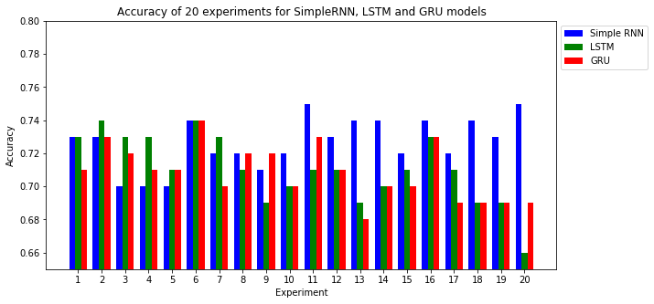
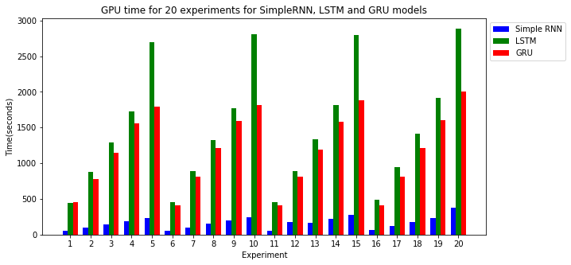
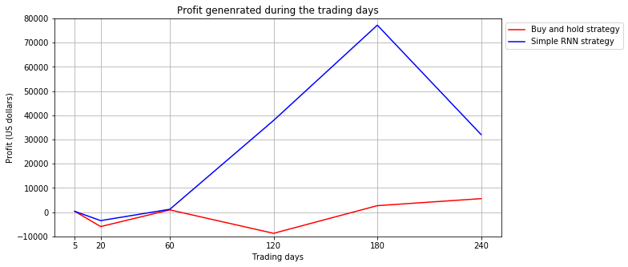

# Recurrent Neural Networks in Forecasting the S&P 500 Index

Code for my master's essay at the African Institute for Mathematical Sciences (AIMS South Africa, 2017),
supervised by Prof. Ronnie Becker and Dr. Bubacarr Bah. The essay is also available as an SSRN working paper:
[ssrn.com/abstract=3001046](https://ssrn.com/abstract=3001046).

The project asks whether recurrent neural networks can predict the daily direction (up or down) of the S&P 500,
and whether a simple trading rule built on those predictions beats buy-and-hold. It compares three architectures:
a simple recurrent neural network (RNN), a long short-term memory network (LSTM) and a gated recurrent unit (GRU).

## Contents

| File | What it does |
|---|---|
| [`01_load_data.ipynb`](01_load_data.ipynb) | Downloads daily adjusted closing prices from Yahoo Finance (January 2009 to April 2017), fills missing values and builds lagged S&P 500 features. Writes `features.csv`. |
| [`02_train_and_evaluate.ipynb`](02_train_and_evaluate.ipynb) | Converts prices to log returns, selects features, trains the RNN/LSTM/GRU classifiers, evaluates them, plots the experiment results and simulates the trading rule. |
| [`features.csv`](features.csv) | The dataset used in the essay: 2,110 trading days for SPY, its three lags, five stock indices and five large S&P 500 stocks. |
| [`figures/`](figures) | Figures from the essay. |
| [`essay.pdf`](essay.pdf) | The full essay: theory (back-propagation through time, vanishing gradients, LSTM, GRU, error-correction networks), method and results. |

## Method

1. **Data.** Daily closes for SPY (the S&P 500 ETF), its values one to three days earlier, the CAC 40, FTSE 100,
   DAX, Dow Jones and NASDAQ indices, and five large S&P 500 constituents (Exxon Mobil, Procter & Gamble,
   General Electric, Microsoft, Johnson & Johnson).
2. **Feature selection.** Features strongly correlated with each other (|ρ| ≥ 0.5) carry the same information, so
   only one from each group is kept. This leaves SPY lagged one day, Johnson & Johnson and the NASDAQ Composite.
3. **Design of experiments.** A full factorial over features, hidden-layer size and training epochs would need
   327,680 runs. A fractional design reduces this to 20 experiments per architecture: hidden layers of 25, 50, 75
   or 100 neurons, trained for 40 to 200 epochs.
4. **Classification.** Each network outputs the probability of an "up" day (sigmoid output, binary
   cross-entropy loss, Adam optimiser, 20% dropout). 80% of observations are used for training and 20% for testing.
5. **Trading rule.** Starting with $100,000: buy when the model predicts a rise and hold cash when it predicts a
   fall. Trades are at the same day's close, with no transaction costs. The result is compared with buy-and-hold
   over 1 week to 1 year.

## Results reported in the essay

| Model | Hidden neurons | Epochs | Test accuracy |
|---|---|---|---|
| Simple RNN | 75 | 40 | 75% |
| LSTM | 25 | 80 | 74% |
| GRU | 50 | 40 | 74% |

The simple RNN was as accurate as the gated architectures and trained about eight times faster.

## Notes on the method

This was a 2017 student project. A 2026 review of the code found issues that mean the reported accuracy and
trading profits should **not** be read as evidence that the networks can forecast the S&P 500:

- **The target makes high accuracy mechanical.** The label is whether today's return is higher than
  yesterday's, not whether the index rose. Because yesterday's return is part of both the label and the inputs,
  the label is partly predictable even when returns are pure noise. On simulated random-walk data, a logistic
  regression with the same features reaches about 68% accuracy. On `features.csv` it reaches 70–71%, close to
  the 74–75% of the networks.
- **The data contain artefacts.** Missing prices were filled with the series average, which creates large
  artificial jumps. `features.csv` has 98 days on which SPY "moves" by more than 10% (its daily standard deviation
  in the file is about 8%, against roughly 1% in reality). These spikes reverse the next day, which further
  inflates predictability.
- **The train/test split is random, not chronological.** `train_test_split` shuffles the days, so the model can
  be trained on days after the test days. A walk-forward split (train on earlier years, test on later ones) is
  the right check.
- **The trading simulation is simplified.** It trades at the same close the signal is computed from and
  ignores transaction costs, bid–ask spreads and taxes.

The essay's lasting contributions are the exposition of recurrent architectures and the comparison of their
training cost. A sound test of predictability would use clean adjusted prices, predict the sign of the next
day's return using only information available today, and evaluate out of sample on a later period.

## Running the code

The notebooks were written in 2017 for Python 2.7 and 3.4 with Keras 2.0 on the Theano backend. They use APIs that
have since been removed, including `pandas.DataFrame.from_csv`, `.ix` indexing, `sklearn.cross_validation` and
the Yahoo source in `pandas_datareader`. They are kept as the record of the essay and will not run unchanged on a
current Python stack. To reproduce the analysis today:

- read `features.csv` with `pd.read_csv("features.csv", index_col=0)` and replace `.ix` with `.loc` or `.iloc`;
- import `train_test_split` from `sklearn.model_selection`, and pass `shuffle=False` to keep time order;
- build the models with `tensorflow.keras` (`SimpleRNN`, `LSTM`, `GRU`, with `input_shape=(3, 1)`).

## Citation

Edet, S. (2017). *Recurrent Neural Networks in Forecasting S&P 500 Index*. AIMS South Africa master's essay.
SSRN: [ssrn.com/abstract=3001046](https://ssrn.com/abstract=3001046)

## Author

**Samuel Edet** · [samueledet.github.io](https://samueledet.github.io)
