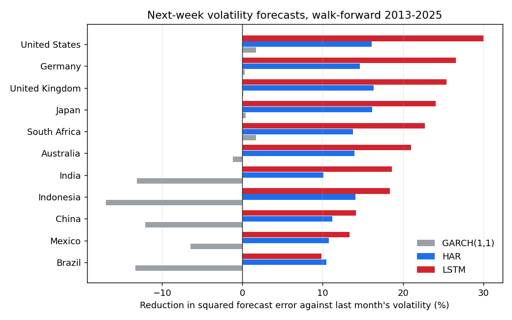
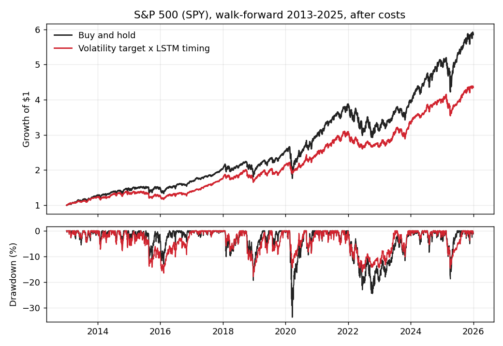

# What Can Recurrent Neural Networks Forecast in Stock Markets?

Recurrent neural networks (simple RNN, LSTM, GRU) tested on stock indices with a strict walk-forward design:
every model is trained only on earlier years and evaluated on the years that follow. Two questions:

1. **Direction.** Can a network predict whether the market will rise, better than simply assuming it will?
2. **Volatility.** Can it forecast how volatile the market will be, and does that help an investor?

Data: daily closing levels of 11 stock indices, five developed (United States, Japan, United Kingdom, Germany,
Australia) and six emerging (Brazil, Mexico, India, China, South Africa, Indonesia), 2005–2025. Test period
2013–2025, about 3,200 trading days per market.

A short write-up: [Forecast the risk, not the return](https://samueledet.github.io/notes/neural-network-forecasts.html).

## Main findings

1. **Daily direction is not predictable.** "Always up" is right 51–55% of the time. The LSTM never beat it by
   more than 0.3 percentage points, and a trading rule built on its signals had a lower Sharpe ratio than buy
   and hold in 9 of 11 markets.
2. **Volatility is.** Against the simplest forecast (last month's volatility), the LSTM reduced the squared
   error of next-week volatility forecasts by 10–30%, median 21%. It was the most accurate model in 10 of 11
   markets, ahead of HAR (median 14%) and GARCH(1,1), which did no better than the simple forecast.
3. **Volatility targeting limits losses but does not add return.** Sizing positions to a 15% volatility target
   with the network's forecasts cut the maximum drawdown in 10 of 11 markets, typically by 6–16 percentage
   points. Its Sharpe ratio beat buy and hold only in India.
4. **Richer inputs help risk-adjusted returns, but not significantly.** For the S&P 500, a model with
   cross-asset features (VIX, yields, credit, gold, the dollar, foreign markets) and a one-month horizon,
   combined with volatility targeting, raised the Sharpe ratio from 0.80 to 0.90 and halved the maximum
   drawdown (−34% to −18%). At the same volatility as buy and hold it would have returned 16.6% a year
   against 14.6%. But its raw return was lower (12.0%), the gain came entirely from 2020–2025, and a block
   bootstrap gives a 28% probability that the Sharpe gain is zero or negative.





## The studies

### 1. Eleven-market walk-forward ([`analysis/forecast_markets.py`](analysis/forecast_markets.py))

For each test year 2013–2025, models are retrained on all data from 2005 to the end of the previous year.
Inputs are each market's own daily returns, absolute returns and realised volatility over 1, 5 and 22 days;
the LSTM sees the last 22 days.

| Task | Target | Models compared |
|---|---|---|
| Direction | Index up tomorrow? | Always up, logistic regression, LSTM (3 seeds) |
| Volatility | Log of average squared return over the next 5 days | Last month's volatility, HAR (Corsi, 2009), GARCH(1,1), LSTM (3 seeds) |
| Use | Volatility targeting: hold min(15% / forecast volatility, 1.5) of the index | Buy and hold; 5 bp cost per unit traded |

Results: [`walk_forward_summary.csv`](analysis/results/walk_forward_summary.csv); daily predictions:
[`walk_forward_predictions.csv`](analysis/results/walk_forward_predictions.csv).

| Market | Always up | LSTM | Vol. error cut: HAR | Vol. error cut: LSTM | Max drawdown, buy and hold | Max drawdown, vol. target |
|---|---|---|---|---|---|---|
| United States | 54.7% | 54.7% | 16% | 30% | −34% | −22% |
| Germany | 53.7% | 53.7% | 15% | 27% | −39% | −28% |
| United Kingdom | 53.5% | 52.0% | 16% | 25% | −37% | −38% |
| Japan | 53.6% | 53.0% | 16% | 24% | −32% | −26% |
| Australia | 54.3% | 53.4% | 14% | 21% | −37% | −24% |
| South Africa | 52.3% | 51.8% | 14% | 23% | −38% | −27% |
| India | 53.5% | 51.2% | 10% | 19% | −38% | −24% |
| Indonesia | 54.0% | 53.8% | 14% | 18% | −41% | −34% |
| China | 52.7% | 53.0% | 11% | 14% | −52% | −39% |
| Mexico | 50.8% | 50.3% | 11% | 13% | −36% | −30% |
| Brazil | 51.4% | 51.2% | 10% | 10% | −47% | −31% |

### 2. S&P 500 with richer features ([`analysis/improve_us.py`](analysis/improve_us.py))

Same walk-forward design for SPY, with all choices fixed in advance:

- **Features:** momentum over 1 day to 1 year, gaps to the 50- and 200-day moving averages, drawdown from the
  one-year high, realised volatility at three horizons, VIX and the variance risk premium, the 10-year and
  3-month yields and the term spread, 20-day returns of Treasuries, corporate bonds, gold and the dollar, and
  same-day returns of the FTSE 100, DAX, Nikkei 225 and Hang Seng. Series that settle after the equity close
  enter with a one-day lag.
- **Target:** SPY up over the next 20 trading days. Training rows whose target overlaps the test year are dropped.
- **Models:** logistic regression, gradient-boosted trees, LSTM (60-day window), and their average.
- **Strategies:** timing (fully invested if the model says up, half invested otherwise), volatility targeting
  with a HAR forecast, and the two combined.

| 2013–2025, after costs | Annual return | Volatility | Sharpe | Max drawdown | Return at buy-and-hold volatility | P(Sharpe gain ≤ 0) |
|---|---|---|---|---|---|---|
| Buy and hold | 14.6% | 17.0% | 0.80 | −34% | 14.6% | – |
| Volatility target (HAR) | 12.6% | 13.9% | 0.85 | −18% | 15.5% | 0.41 |
| Timing: LSTM | 13.8% | 15.9% | 0.81 | −32% | 14.8% | 0.42 |
| Volatility target × timing: LSTM | 12.0% | 12.5% | 0.90 | −18% | 16.6% | 0.28 |
| Volatility target × timing: ensemble | 12.0% | 13.2% | 0.86 | −18% | 15.7% | 0.39 |

The models' one-month accuracy (57–69%) was at or below that of "always up" (70%). The modest gains come from
volatility management, and from 2020–2025: in 2013–2019 every strategy had a lower Sharpe ratio than buy and
hold. Full table, including sub-periods: [`us_improved_summary.csv`](analysis/results/us_improved_summary.csv).

### 3. The original question, re-tested ([`analysis/us_direction_rerun.py`](analysis/us_direction_rerun.py))

The 2017 networks and settings, on clean data, predicting whether SPY rises tomorrow, with a time-ordered split:

| Test period | Always up | Simple RNN | LSTM | GRU |
|---|---|---|---|---|
| Sep 2015 – Apr 2017 | 53.1% | 52.1% | 54.0% | 52.6% |
| 2020 – 2025 (trained on 2009–2019) | 55.1% | 50.0% | 49.4% | 48.7% |

## Background: the 2017 paper

This project started as my master's essay at the African Institute for Mathematical Sciences (2017), also an SSRN
working paper: [ssrn.com/abstract=3001046](https://ssrn.com/abstract=3001046). It reported that recurrent
networks predicted the S&P 500's daily direction about 74% of the time. That figure came from the design, not
the networks: the label was whether today's return beat yesterday's, and yesterday's return was also an input,
so it was partly predictable from noise alone. On clean data a logistic regression reproduces it (74%), and
random numbers reach 65% ([`essay_label_check.csv`](analysis/results/essay_label_check.csv)). The data also
contained artefacts from filling missing prices with averages, and the train/test split was random rather
than chronological. The original notebooks, data and essay are kept unchanged in [`essay-2017/`](essay-2017).

## Running it

```bash
pip install numpy scipy pandas scikit-learn torch matplotlib
cd analysis
python get_prices.py ^GSPC ^N225 ^FTSE ^GDAXI ^AXJO ^BVSP ^MXX ^BSESN 000001.SS ^J200.JO ^JKSE \
    --start 2005-01-01 --end 2026-01-01
python forecast_markets.py          # about 1 hour on 4 CPU cores
python get_prices.py SPY ^VIX ^TNX ^IRX TLT LQD GLD DX-Y.NYB ^FTSE ^GDAXI ^N225 ^HSI \
    --start 2004-01-01 --end 2026-01-01 --out data_us
python improve_us.py                # about 20 minutes
python get_prices.py SPY ^FCHI ^FTSE ^GDAXI ^DJI ^IXIC ^HSI XOM GE MSFT PG JNJ \
    --start 2008-10-01 --end 2026-01-01
python us_direction_rerun.py
python make_figures.py
```

Prices come from Yahoo Finance and are not stored in the repository.

## Limitations

- Index levels are price indices in local currency; dividends are excluded.
- One network design per task, with settings fixed in advance rather than tuned. Different architectures or
  inputs could do better; the point of fixing them is that the test years were never used for choices.
- Trading costs are a flat 5 basis points per unit traded; taxes, financing costs for exposure above 100% and
  market impact are ignored.
- The test period, 2013–2025, contains one very sharp crash (2020), which favours volatility management.

## Author

**Samuel Edet** · [samueledet.github.io](https://samueledet.github.io)
